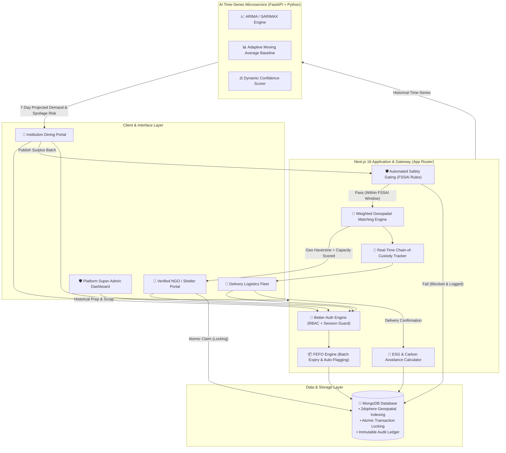

# 🍽️ ZeroPlate AI

<div align="center">

### Intelligent Food Waste Reduction, FEFO Inventory & Safe Redistribution Ecosystem

[](https://nextjs.org/)
[](https://react.dev/)
[](https://fastapi.tiangolo.com/)
[](https://www.python.org/)
[](https://www.mongodb.com/)
[](https://www.typescriptlang.org/)
[](https://tailwindcss.com/)
[](https://www.better-auth.com/)
[](LICENSE)
[](https://sdgs.un.org/)

<br />

**ZeroPlate AI** is a closed-loop food waste mitigation and redistribution platform engineered for institutional kitchens (universities, colleges, corporate dining facilities, and hospitals) and verified community shelters / NGOs.

[Explore Architecture](#-system-architecture) • [Key Features](#-core-innovations--platform-features) • [User Portals](#-role-based-ecosystems) • [Getting Started](#-getting-started) • [API & Tests](#-verification--test-suites)

</div>

---

## 📖 Executive Summary

Food waste in institutional catering is an operational, logistical, and environmental crisis. Over **15% to 25%** of daily meals cooked in large kitchens go uneaten due to volatile headcount swings, academic calendar shifts, weather variations, and batch cooking constraints. Concurrently, community night shelters, orphanages, and food banks located within a 5–15 km radius suffer chronic meal shortages.

Most surplus food is dumped because kitchens lack:
1. **Predictive visibility**: Kitchen managers cook for static attendance numbers instead of dynamic forecasted demand.
2. **First-Expired, First-Out (FEFO) automation**: Perishable ingredients spoil in storage before cooks realize they are near expiration.
3. **Automated food safety compliance**: Liability and food poisoning risks prevent donation without verifiable safety checks.
4. **Instant, conflict-free logistics**: Manual calls and messaging lead to double-claiming, expired pickup windows, and transit drop-offs.

**ZeroPlate AI resolves this end-to-end through a self-learning closed loop:**

$$\text{Forecast Demand} \longrightarrow \text{FEFO Kitchen Stocking} \longrightarrow \text{Multi-Factor Safety Gate} \longrightarrow \text{Weighted Geo-Matching} \longrightarrow \text{Audit-Ready ESG Loop}$$

---

## 🏗️ System Architecture

ZeroPlate AI is architected as a modern, decoupled hybrid system with a Next.js full-stack core and a specialized Python FastAPI time-series microservice.



---

## ✨ Core Innovations & Platform Features

### 1. 🧠 AI Demand & Surplus Forecasting
* **Dual-Engine Model**: Combines auto-regressive time-series modeling (`ARIMA`) with fallback rolling-window moving averages to handle cold-start conditions seamlessly.
* **7-Day Dynamic Horizons**: Generates daily demand projections across cooked items, staples, bakery, and dairy.
* **Confidence & Anomaly Bounds**: Computes upper/lower variance thresholds and warns chefs when surplus risk spikes above 15% prior to morning food prep.

### 2. 📦 FEFO (First-Expired, First-Out) Inventory Intelligence
* **Batch-Level Shelf-Life Tracking**: Every ingredient and batch is tagged with its expiration date, storage temperature, and receipt time.
* **Proactive Spoilage Prevention**: Highlights near-expiry lots directly on the chef's daily kitchen prep sheet to ensure oldest usable stock is prepared first.
* **Auto-Flagging & Surplus Transition**: Items that cannot be utilized in today's menu are automatically routed to the surplus redistribution workflow before quality deteriorates.

### 3. 🛡️ Fail-Closed Multi-Criteria Food Safety Gating
* **Strict FSSAI Alignment**: Adheres to the Food Safety and Standards Authority of India surplus redistribution parameters:
  * Maximum allowable shelf-life from cooking to delivery (default $\le$ 4 hours for high-risk cooked foods).
  * Storage temperature monitoring (hot holding $\ge 60^\circ\text{C}$, cold holding $\le 5^\circ\text{C}$).
  * Organoleptic visual and aroma verification checkpoints.
* **Fail-Closed Architecture**: Missing sensor readings, expired timestamps, or evaluation errors result in an automatic rejection to guarantee recipient safety.
* **Immutable Audit Trail**: Every gating decision is stored permanently in the MongoDB `auditLogs` collection with rejection reasons.

### 4. 🎯 Weighted Algorithmic Geospatial Matching
* **Multi-Factor Score**: Matches surplus food with candidate NGOs within operating radius using a balanced scoring formula:
  $$\text{Match Score} = (0.45 \times \text{Proximity Score}) + (0.35 \times \text{Capacity Fit}) + (0.20 \times \text{Reliability Index})$$
* **Haversine Geospatial Optimization**: Leverages spherical coordinates and MongoDB `2dsphere` indexes to evaluate real travel distances.
* **Atomic Claim Locking**: Guarantees zero race conditions or double-claims using atomic MongoDB document mutations and state locks.

### 5. 🚚 Chain-of-Custody Logistics Tracking
* **Discrete State Progression**: 
  $$\texttt{assigned} \longrightarrow \texttt{accepted} \longrightarrow \texttt{picked\_up} \longrightarrow \texttt{delivered} \longrightarrow \texttt{confirmed}$$
* **Interactive Leaflet Mapping**: Live coordinates, route visualization, and pickup/dropoff markers.
* **Recipient Verification**: Direct digital receipt verification by the NGO shelter manager closes the custody loop.

### 6. 📊 Real-Time ESG & Sustainability Impact Engine
* **Carbon Avoidance Calculation**: Converts salvaged food kilograms directly into GHG metrics based on FAO standards:
  $$\text{CO}_2\text{e Avoided} = \text{Rescued Mass (kg)} \times 2.5\text{ kg CO}_2\text{e/kg}$$
* **Social Metrics**: Automatically tallies total meals delivered, people nourished, and virtual water conserved.
* **CSR & ESG Reporting**: Generates audit-ready sustainability metrics suitable for institutional CSR filings and green building certifications.

---

## 👥 Role-Based Ecosystems

| Portal | Target User | Key Capabilities |
| :--- | :--- | :--- |
| **🏫 Institution Admin** | University Dining Halls, Hospitals, Corporate Canteens | • Real-time FEFO inventory management & batch expiration alerts<br>• 7-day AI demand forecasting & recommended prep volumes<br>• 1-click surplus publishing with automated safety validation<br>• Live dispatch tracking and cumulative ESG impact dashboard |
| **🤝 Verified NGO** | Orphanages, Night Shelters, Community Kitchens | • KYC onboarding & verification status monitoring<br>• Geospatial browse and search of verified safe food listings<br>• 1-click atomic claiming of surplus batches<br>• Delivery arrival tracking and food condition acknowledgment |
| **🚚 Delivery Fleet** | In-house Campus Drivers, Volunteer Couriers | • Dedicated mobile-responsive delivery workflow<br>• Turn-by-turn route overview with interactive Leaflet maps<br>• Instant status transitions (`accepted` $\to$ `picked_up` $\to$ `delivered`)<br>• Chain-of-custody transfer confirmation |
| **🛡️ Platform Admin** | Compliance Officers, System Super-Admins | • NGO KYC document review & verification approval/rejection<br>• Global food safety threshold configuration & category policies<br>• Full system audit trail inspections and user role governance<br>• Macro ecosystem performance metrics & platform reporting |

---

## 💻 Tech Stack

### Web Application & API
* **Framework**: [Next.js 16](https://nextjs.org/) (App Router, Server Actions, API Route Handlers)
* **Frontend**: [React 19](https://react.dev/), [TypeScript 5](https://www.typescriptlang.org/)
* **Styling**: [Tailwind CSS 4](https://tailwindcss.com/), [Shadcn UI](https://ui.shadcn.com/), Lucide Icons
* **Data Visualization**: [Recharts](https://recharts.org/)
* **Mapping & GIS**: [Leaflet](https://leafletjs.com/) with OpenStreetMap tiles

### Forecasting Microservice
* **Service Framework**: [FastAPI](https://fastapi.tiangolo.com/) (Asynchronous ASGI)
* **Computation Engine**: [NumPy](https://numpy.org/), [Pandas](https://pandas.pydata.org/), `statsmodels`
* **Validation**: [Pydantic v2](https://docs.pydantic.dev/)

### Persistence, Security & Communications
* **Primary Database**: [MongoDB Atlas](https://www.mongodb.com/) (Node.js native driver `v7`, `2dsphere` indexes)
* **Authentication**: [Better-Auth](https://www.better-auth.com/) with Role-Based Access Control (RBAC)
* **Email & Alerts**: [Resend](https://resend.com/) API integration

---

## 📂 Repository Structure

```
ZeroPlate.ai_MVP/
├── app/                              # Next.js App Router
│   ├── (auth)/                       # Sign-in, Register, Password Reset
│   ├── about/                        # Platform mission & team
│   ├── api/v1/                       # RESTful API Gateway
│   │   ├── admin/                    # NGO verification & compliance policies
│   │   ├── ai/                       # AI intelligence & prediction routes
│   │   ├── analytics/                # ESG & sustainability metrics
│   │   ├── delivery/                 # Fleet dispatch & route lifecycle
│   │   ├── forecast/                 # Next.js proxy to FastAPI microservice
│   │   ├── institution/              # Kitchen analytics & inventory routes
│   │   ├── inventory/                # FEFO engine endpoints
│   │   ├── ngo/                      # Surplus claiming & KYC endpoints
│   │   └── surplus-listings/         # Safety gated surplus listings
│   ├── dashboard/                    # Role-specific portals
│   │   ├── admin/                    # Platform administration
│   │   ├── delivery/                 # Driver pickup & dropoff console
│   │   ├── institution/              # Dining hall management console
│   │   └── ngo/                      # Shelter discovery & claiming console
│   ├── food-safety-policy/           # FSSAI compliance documentation
│   ├── impact/                       # Public ESG metrics page
│   ├── inventory/                    # Kitchen stock tracker
│   └── surplus-listings/             # Active community food feed
├── components/                       # Shared UI and layout primitives
├── forecast_service/                 # Standalone Python microservice
│   ├── main.py                       # FastAPI forecasting API & ARIMA logic
│   └── requirements.txt              # Python dependencies
├── lib/                              # Core Domain & Business Logic
│   ├── auth.ts                       # Better-Auth server configuration
│   ├── demand-prediction.ts          # Forecast coordination & fallback models
│   ├── fefo-engine.ts                # First-Expired, First-Out core algorithm
│   ├── matching.ts                   # Geospatial weighted matching
│   ├── mongodb.ts                    # Reusable MongoDB client connection pool
│   ├── notifications.ts              # In-app and email alert dispatcher
│   ├── safety-gating.ts              # Multi-factor FSSAI safety validation
│   └── sustainability.ts             # CO2e & water impact calculations
├── public/                           # Static assets & icons
├── scripts/                          # Automated test & verification suites
│   ├── test-admin-experience.mjs     # Admin verification suite
│   ├── test-auth-flow.mjs            # Authentication & RBAC suite
│   ├── test-delivery-experience.mjs  # Fleet dispatch & tracking suite
│   ├── test-fefo-engine.mjs          # FEFO algorithm validation suite
│   ├── test-final-verification.mjs   # Comprehensive end-to-end suite
│   ├── test-matching-logistics.mjs   # Geospatial matching test suite
│   ├── test-ngo-experience.mjs       # NGO claim & confirmation suite
│   └── test-safety-gating.mjs        # FSSAI safety gating suite
├── .env.example                      # Sample configuration variables
├── LICENSE                           # MIT License
├── package.json                      # Node.js dependencies & scripts
└── tsconfig.json                     # TypeScript compiler configuration
```

---

## 🚀 Getting Started

### Prerequisites
* **Node.js**: v20.x or higher
* **npm**: v10.x or higher
* **Python**: v3.10+ (for the forecasting service)
* **MongoDB**: A running MongoDB instance (Atlas URI or local `mongodb://localhost:27017`)

---

### Step 1: Clone the Repository

```bash
git clone https://github.com/RajJasani/ZeroPlate_ai.git
cd ZeroPlate_ai
```

---

### Step 2: Configure Environment Variables

Create a `.env.local` file in the root directory:

```bash
cp .env.example .env.local
```

Populate the required keys in `.env.local`:

```env
# Database
MONGODB_URI=mongodb+srv://<user>:<password>@cluster0.mongodb.net/?retryWrites=true&w=majority
MONGODB_DB_NAME=ZeroPlate_ai_MVP

# Authentication (Better-Auth)
BETTER_AUTH_SECRET=your_super_secret_at_least_32_characters_long_string
BETTER_AUTH_URL=http://localhost:3000

# Optional: Google OAuth
GOOGLE_CLIENT_ID=your_google_client_id
GOOGLE_CLIENT_SECRET=your_google_client_secret

# AI Forecasting Microservice
FASTAPI_FORECAST_URL=http://localhost:8000

# Transactional Notifications
RESEND_API_KEY=your_resend_api_key_here
EMAIL_FROM=ZeroPlate <notifications@yourdomain.com>
```

---

### Step 3: Install Dependencies & Run the Next.js App

```bash
# Install frontend and server dependencies
npm install

# Start the Next.js development server
npm run dev
```

The web application will be live at `http://localhost:3000`.

---

### Step 4: Run the Python Forecasting Microservice (Optional but Recommended)

In a separate terminal window:

```bash
cd forecast_service

# Create and activate virtual environment
python3 -m venv venv
source venv/bin/activate  # On Windows: venv\Scripts\activate

# Install requirements
pip install -r requirements.txt

# Start FastAPI server via Uvicorn
uvicorn main:app --reload --port 8000
```

Interactive FastAPI documentation will be available at `http://localhost:8000/docs`.

---

## 🧪 Verification & Test Suites

ZeroPlate AI includes an extensive suite of automated test harnesses in the `scripts/` folder to validate core business logic, safety rules, and concurrency:

```bash
# 1. Verify Authentication, Registration & RBAC
node scripts/test-auth-flow.mjs

# 2. Test Multi-Factor Food Safety Gating (FSSAI Rules & Fail-Closed Logic)
node scripts/test-safety-gating.mjs

# 3. Test FEFO Expiration & Near-Expiry Auto-Flagging
node scripts/test-fefo-engine.mjs

# 4. Test Geospatial Weighted Matching & Haversine Scoring
node scripts/test-matching-logistics-forecast.mjs

# 5. Test NGO Experience (Discovery, Atomic Lock Claim, Receipt Confirmation)
node scripts/test-ngo-experience.mjs

# 6. Test Delivery Partner Transit Progression (Accepted -> Delivered)
node scripts/test-delivery-experience.mjs

# 7. Test Admin Operations (KYC Approval & Safety Rule Tweaks)
node scripts/test-admin-experience.mjs

# 8. Run Full End-to-End System Stage Verification
node scripts/test-final-verification.mjs
```

---

## 🌐 Alignment with UN Sustainable Development Goals

| Goal | Title | ZeroPlate AI Direct Contribution |
| :---: | :--- | :--- |
|  | **Zero Hunger** | Bridges the gap between excess kitchen portions and local night shelters, ensuring safe, wholesome meals reach underserved communities. |
|  | **Responsible Consumption** | Prevents systemic kitchen over-preparation using time-series AI forecasting and implements FEFO inventory handling. |
|  | **Climate Action** | Diverts organic waste away from municipal landfills, preventing harmful anaerobic decomposition and methane emissions. |

---

## 📜 Regulatory Standards & Food Safety

ZeroPlate AI is built to comply with the guidelines defined by the **Food Safety and Standards Authority of India (FSSAI)**:
* **FSS (Recovery and Distribution of Surplus Food) Regulations**: Temperature tracking, labeling, transport hygiene, and expiration ceilings.
* **Good Samaritan Protections**: Verifiable chain-of-custody handoffs protect well-intentioned food donors against liability when food is handled in good faith according to safety criteria.

---

## 🤝 Contributing

Contributions, bug reports, and suggestions are welcome!

1. Fork the Project repository
2. Create your Feature Branch (`git checkout -b feature/AmazingFeature`)
3. Commit your Changes (`git commit -m 'Add some AmazingFeature'`)
4. Push to the Branch (`git push origin feature/AmazingFeature`)
5. Open a Pull Request

---

## 📄 License

Distributed under the **MIT License**. See [`LICENSE`](LICENSE) for full details.

---

<div align="center">

Crafted with care to eliminate food waste and fight hunger.  
**ZeroPlate AI** • *Every Meal Counts.*

</div>
